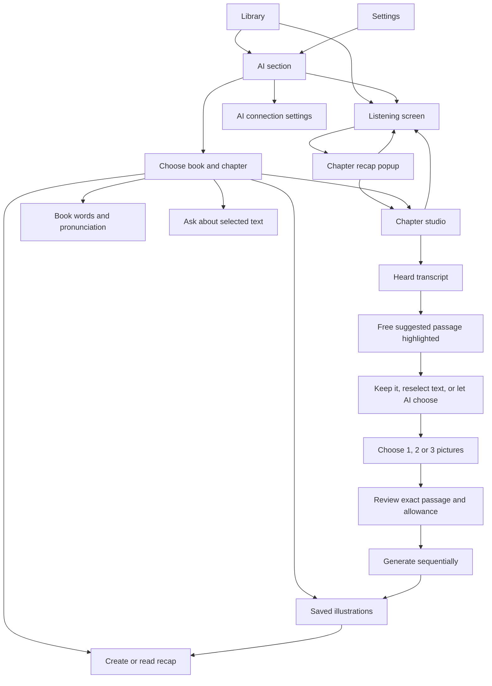

# Narrumo 1.9: AI user flow

The bottom navigation is **Library · Bookmarks · AI · Settings**. Settings and book details link to the same AI section. The listening screen retains a small AI companion card and a one-tap last-chapter recap on Library.

The chapter studio places the illustration panel immediately beneath a scrollable transcript. A free suggestion uses only available, already-heard chapter text; its passage preview is visible and the source lines are highlighted. Long-press text → **Use for illustration**, or select text and use the visible button, to replace it. **Let AI choose a key moment** is an explicitly confirmed request using one shared text attempt. AI returns only validated cue indices, so it cannot supply an invented passage.

Choose 1–3 pictures, then review the exact passage before confirming. Each picture is one medium-quality, four-panel graphic-novel page. Multiple pictures use different framing of the same selected moment. They are requested sequentially and cached individually; failure stops the remaining batch, without automatic retries. Leaving stops pages not yet started. Saved pictures link directly to their chapter even if no recap exists yet. Rewinding hides unavailable source passages and pictures.

The private server shares 25 chapter summary attempts, 20 other text attempts, and 3 image attempts per UTC day. Failed generation attempts count. Reading saved content, free passage suggestions and local transcription use no AI allowance. Android transcription remains English and may mishear names; review the source passage before creating pictures.
